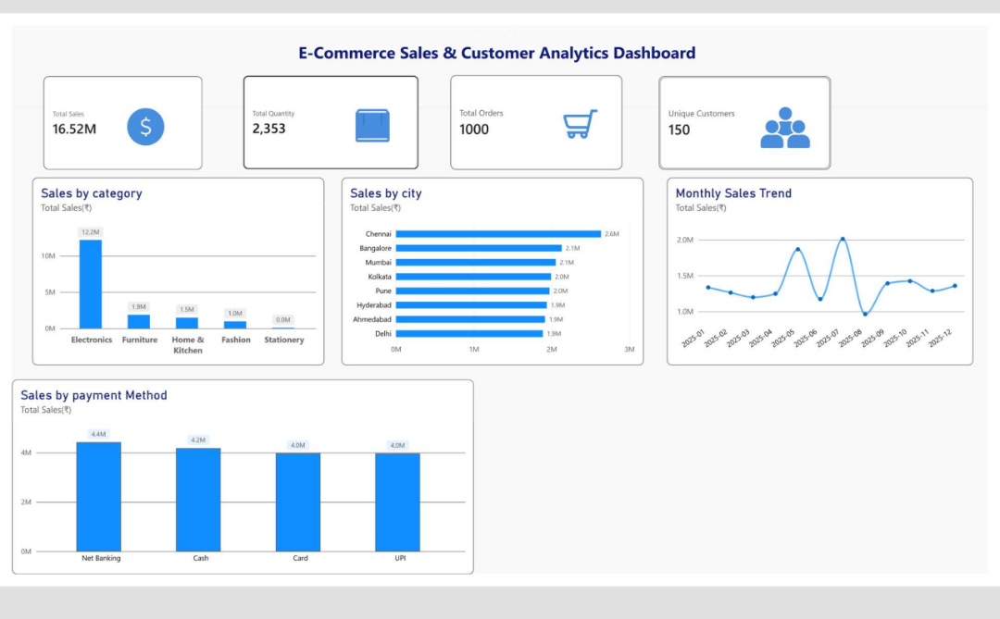

# E-Commerce Sales & Customer Analytics Dashboard - Power BI

## 📊 Project Overview
Analyzed 1000+ orders and 150 customers with 16.52M total sales to uncover business insights on city, category & payment trends.

## 🔍 Key Insights
- **Total Sales:** 16.52M | **Orders:** 1000 | **Customers:** 150 | **Quantity:** 2353
- **Top City:** Chennai (2.6M)
- **Top Category:** Electronics
- **Top Payment:** Net Banking (4.6M)
- **Monthly Trend:** Peaked in May & July 2025

### 🛠️ Tools Used

- Power BI Desktop
- Data Cleaning & Modeling
- DAX
- Python (Pandas, Data Analysis) - DAY2_ANALYSIS.py
- SQL (MySQL, Queries & Aggregations) - Ecommerce_Sql_practiseday5.sql
- GitHub

## 📸 Dashboard Preview

## 📁 Files
- .pbix file - Power BI source
- .pdf file - Final dashboard

## 💡 What I Learned
- Fixed checkered icon backgrounds
- Sorted monthly data correctly (YYYY-MM)
- Handled OneDrive sync errors
- KPI design & storytelling

Created by Manasa | Aspiring Data Analyst
#PowerBI #DataAnalytics
